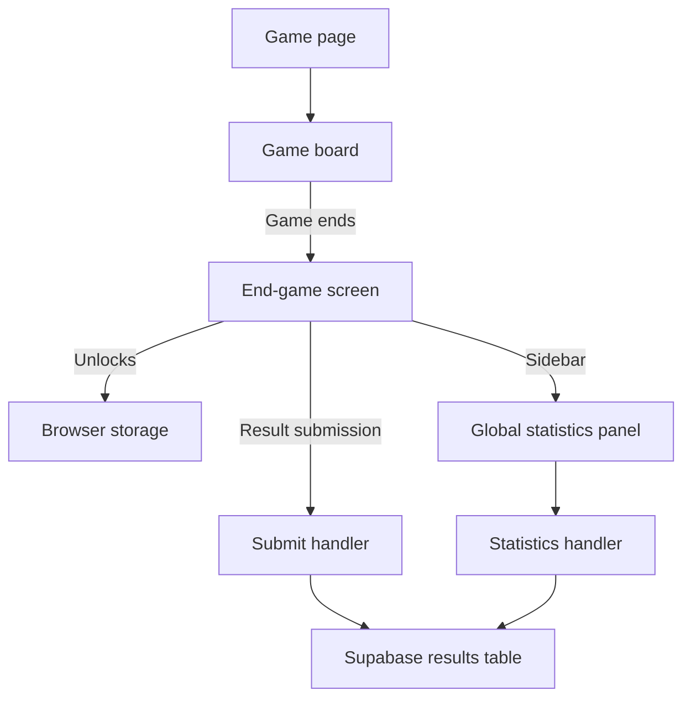

# Architecture

Spooky Monopoly is a Next.js App Router app written in TypeScript. The root layout and page render the game entry point. Browser-side React components own game state. The two route handlers read and write shared results through Supabase when configured.

| Path | Responsibility |
| --- | --- |
| [app/page.tsx](../app/page.tsx) and [app/layout.tsx](../app/layout.tsx) | Game entry page, page metadata, and site layout. |
| [app/game/GameBoard.tsx](../app/game/GameBoard.tsx) | Owns the turn, position, money, properties, and restart state. Coordinates the token picker, sidebar, and property popup. |
| [app/game/data/](../app/game/data/) | Board spaces, playable tokens, and turn limit. |
| [app/game/EndGame.tsx](../app/game/EndGame.tsx) and [app/game/utils/](../app/game/utils/) | Calculates and renders results, applies token unlocks, and sends the result. Helpers cover titles, achievements, messages, and browser storage. |
| [app/game/GlobalStats.tsx](../app/game/GlobalStats.tsx) and [app/game/types.ts](../app/game/types.ts) | Displays aggregated results and defines shared statistics types. |
| [app/api/](../app/api/) | `POST /api/submit` inserts a game result with a server-generated timestamp. `GET /api/stats` reads results and aggregates them for the panel. Both use the same Supabase configuration helper. |
| [app/server/multiplayer/](../app/server/multiplayer/) | Two-seat rules, seat authentication, and atomic SQLite commits for turns and their receipts. See the [pilot setup](multiplayer-rules.md#run-the-private-pilot). |
| [app/multiplayer/](../app/multiplayer/) and [app/api/multiplayer/](../app/api/multiplayer/) | Private lobby, ready controls, and turn polling. The pilot is opt-in and its database is separate from solo statistics. |
| [next.config.ts](../next.config.ts) | Rewrites `/2025/spooky` to the root and preserves the old stats and submit URLs under `/2025/spooky/api/`. |

During play, the board reads the static board and token data, then updates browser state after each roll and property choice. At the end, the results screen records earned unlocks in local storage. It separately submits a result to the server. The statistics panel reads combined results from `wwo_2025_spooky_game_stats` and can show totals and breakdowns by token group.

The API returns HTTP 503 when either Supabase setting is missing. A configured table with zero results returns a successful response with zero totals and empty counts. The statistics panel handles unavailable results separately from the game. Browser storage is specific to the origin and profile, so a different localhost port or a private browser window starts with its own unlocks.

For a board change, start in `app/game/data/` and check how the board and property popup consume the data. For a change to statistics fields or behaviour, trace the result from `EndGame.tsx` through the write and read handlers to `GlobalStats.tsx`. For a URL change, check the page, affected handler, and rewrite together. See [Development](development.md) for verification and [Decisions](decisions.md) for the rationale behind these boundaries.
